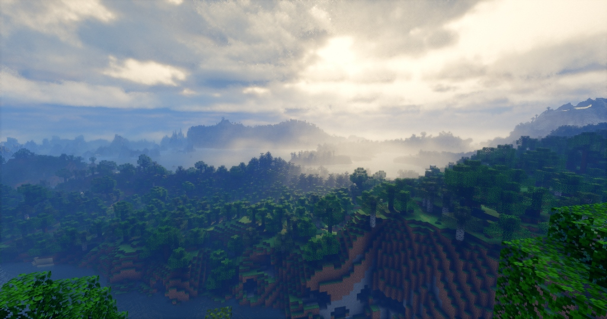

# Orizon Shader

**Orizon Shader** is an advanced, highly-customizable Minecraft shaderpack based on **Bliss Shader** (originally created by **X0nk**, based on **Chocapic13 Shaders**). 

It enhances the visual experience with a focus on majestic atmospheric depth, lifelike volumetric clouds, seamless Distant Horizons / LODs rendering, refined color grading, and comprehensive multi-language support (Full English and Thai).

---

## ✨ Key Features & Highlights

- 🌄 **Distant Horizons & LODs Optimization**: Built-in support for ultra-distant rendering with fixed vertex LOD decoding, proper depth transitions, and zero artifacting.
- ☁️ **Dynamic Volumetric Clouds & Sky**: Soft, multi-layered 3D clouds that realistically react to sunlight, moon phases, and daily weather systems.
- 🌫️ **Atmospheric Fog & Haze**: Physically-inspired Rayleigh and Mie scattering, providing rich sunrise, noon, and sunset color transitions.
- 💡 **Advanced Lighting & Shadows**: Smooth direct light, subsurface scattering (SSS) for leaves and vegetation, and colored translucent shadows (stained glass).
- 🌿 **Organic Environment Motion**: Customizable wind swaying for foliage, plants, and water surfaces.
- 🌐 **Full Dual-Language Support**: Complete native English (`en_us`) and Thai (`th_th`) localization for all in-game shader settings and tooltips.

---

## 📸 Screenshots

---

## 📥 How to Install & Download

### Using with Iris / Sodium (Recommended)
1. Download this repository as a `.zip` file:
   - Click the green **Code** button at the top-right of this repository.
   - Click **Download ZIP**.
2. Alternatively, grab the latest `.zip` release from the **Releases** section.
3. Move the downloaded `.zip` file into your Minecraft `.minecraft/shaderpacks/` folder.
   *(You do **not** need to extract the zip file)*.
4. Launch Minecraft with **Iris + Sodium** (or OptiFine), go to **Video Settings -> Shader Packs**, and select **Orizon-Shader**.

### Recommended Mods for Best Experience:
- **Iris Shaders**
- **Sodium**
- **Distant Horizons** (for grand vista distance rendering)

---

## 🙏 Credits & Special Thanks

- **X0nk** — Creator of [Bliss Shader](https://github.com/X0nk/Bliss-Shader) for the outstanding foundation, custom tonemapping, and innovative design.
- **Chocapic13** — For the original [Chocapic13' Shaders](https://www.curseforge.com/minecraft/customization/chocapic13-shaders) base.
- **WoMspace** — Depth of Field overhaul.
- **Null** — Voxel floodfill colored lighting.
- **EminGT & Gri573** — Light leak prevention techniques.
- **RRe36 & SixthSurge** — Inspiring shader techniques and concepts.
- **Arjinkim** — Orizon Shader development, Far LODs pipeline fixes, and complete Thai translation.

---

## 📄 License
This project follows the original licensing and attribution guidelines of Chocapic13 and Bliss Shader. See [LICENSE.md](LICENSE.md) and [CREDITS.txt](CREDITS.txt) for full details.
